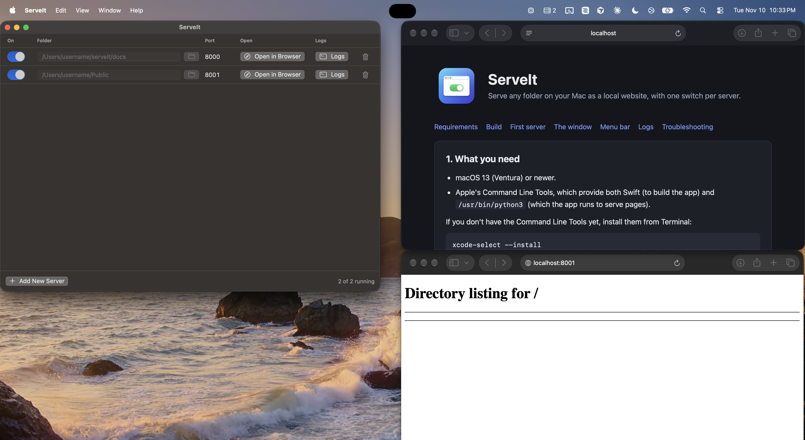

# ServeIt

A small macOS app for serving folders as local websites. Each row is one web server with its own port and an on/off switch. Under the hood it runs `python3 -m http.server`.



## Features

- One switch per server to start and stop it
- Ports assigned automatically, so several servers can run side by side
- Open any running server in your browser with one click
- Live console logs for each server, in a tabbed Logs window
- A menu bar item to control servers while the window is closed

## Quick start

Requires macOS 13 or newer and Apple's Command Line Tools (`xcode-select --install`).

```bash
./build.sh
open build/ServeIt.app
```

Then click **Add New Server**, choose a folder, flip the switch on, and click **Open in Browser**.

## Documentation

The full getting-started guide is in [docs/index.html](docs/index.html). It covers setup, every control in the window, the menu bar item, logs, and troubleshooting.

GitHub shows that file as source, so open it locally to read it:

```bash
open docs/index.html
```

Or serve the `docs` folder with ServeIt itself, as in the screenshot above.

## Project layout

| Path | Purpose |
| --- | --- |
| `Sources/ServeIt/` | SwiftUI app source |
| `Resources/` | `Info.plist` and the app icon |
| `scripts/make-icon.sh` | Regenerates the app icon |
| `build.sh` | Builds and packages `build/ServeIt.app` |
| `docs/` | Getting-started guide and screenshot |

## Notes

- Servers listen on `127.0.0.1` only, so they are not reachable from other devices on your network.
- Quitting ServeIt stops all of its servers.
- This is a development server. Don't use it to host a public site.

## License

See [LICENSE](LICENSE).
